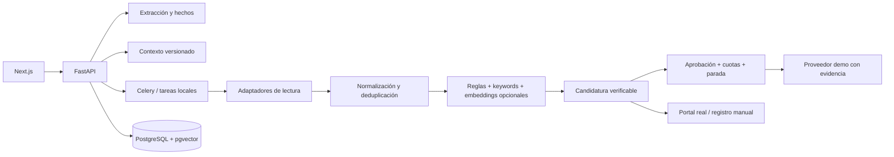

# Arquitectura

Next.js consume FastAPI directamente con TanStack Query, sin login. Un singleton persistente
`local_workspace` vincula el propietario interno y conserva sus datos entre visitas. Pydantic valida fronteras; servicios de dominio
trabajan con modelos tipados sin dependencia de BD. SQLAlchemy gestiona repositorio y transacciones;
Alembic contiene un esquema inicial explícito. La separación evita multiplicar archivos vacíos
con nombres de agentes que no añadan comportamiento.

## Versiones, caché y concurrencia

Cada edición crea versiones inmutables de perfil/contexto. Evaluaciones se cachean por cuenta,
vacante, ambas versiones y configuración del motor. Modificar el perfil/contexto invalida la
aprobación utilizable; una candidatura antigua debe regenerarse. Las confirmaciones de envíos
ya realizados conservan el snapshot histórico.

La BD impone unicidad de vacante por cuenta/fingerprint y por cuenta/fuente/ID externo,
además de una candidatura por cuenta/vacante. Los cambios de título o ubicación de una
publicación no crean otra candidatura. El historial conserva la primera instantánea de la oferta;
no se presenta como una sincronización del cierre o edición posterior del portal.
Una fila de usuario bloqueada con `FOR UPDATE` serializa edición, cuotas, parada y envíos en
PostgreSQL; las entidades se refrescan bajo lock. El identificador estable de candidatura
es la clave idempotente del proveedor demo. No se implementa un proveedor real sin un protocolo
equivalente de idempotencia/reconciliación. SQLite es una alternativa local con garantías de
concurrencia más limitadas; múltiples workers requieren PostgreSQL.

La caché de feeds usa fila bloqueada por fuente/portal, refrescada como máximo cada seis horas
para todas las cuentas y consultas. Los filtros de texto se aplican localmente. Una búsqueda
STARTED usa timestamp; el worker puede recuperarla después de cinco minutos (el límite de tarea
es tres minutos). Retry-After y cooldown de fuente se persisten, compartidos entre cuentas;
recuperar una tarea no anticipa un reintento futuro. El scheduler único evita duplicar programación;
no desplegar varias réplicas.

## Matching

Pesos configurables: técnica 30%, experiencia 20%, seniority 15%, preferencias 15%, salario 10%,
idiomas 10%. Se normalizan a su suma. La ausencia de salario no se interpreta como cero;
no se convierten monedas implícitamente. Un salario mínimo no verificable bloquea elegibilidad.
Se comprueban ubicación, modalidad, exclusiones, experiencia, idiomas y requisitos obligatorios.
`cities` y `contract_types` expresan restricciones; `preferred_cities` y `preferred_contract_types`
ajustan la puntuación sin excluir alternativas. Una jornada completa no prueba un contrato indefinido.
El salario deseado mejora la puntuación frente al mínimo aceptable; el extremo superior del rango deseado
no excluye ofertas mejor pagadas. Si se habilita `salary_below_minimum_requires_review`, una oferta inferior
al mínimo se mantiene pendiente de información para revisar sus condiciones, sin habilitar envío automático.
Los requisitos libres que no se pueden demostrar quedan pendientes, sin importar el score.

Embeddings opcionales ajustan el componente técnico (80% keywords, 20% similitud real), nunca
el resultado de requisitos obligatorios. PostgreSQL calcula distancia coseno con pgvector;
SQLite usa coseno local para desarrollo. Los embeddings se cachean por cuenta/modelo/contenido.

## Estados

`DISCOVERED → ANALYZED → ELIGIBLE → PREPARED → PENDING_APPROVAL → PREPARED → SUBMITTED → CONFIRMED`.
Alternativos: REJECTED_BY_RULES, NEEDS_INFORMATION, FAILED, RETRY_PENDING, SKIPPED y WITHDRAWN.
Las transiciones permitidas están en `services/application_manager.py` y dejan un evento.
Un registro manual de confirmación conserva `platform_verified=false`; sólo declara lo informado
por el usuario. Retirar una candidatura actualiza seguimiento local, no un ATS externo.
